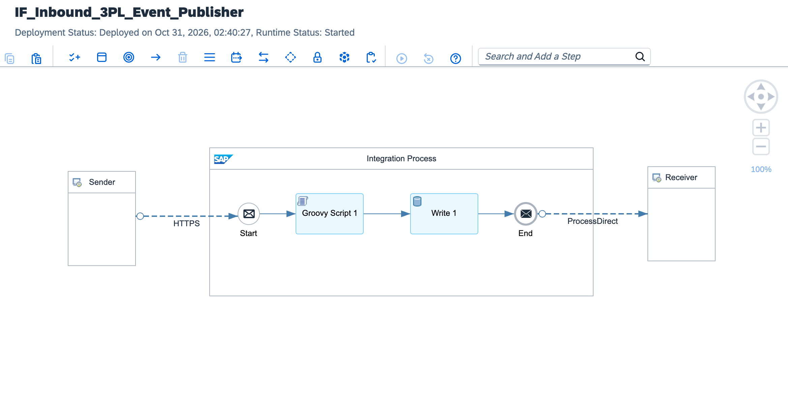
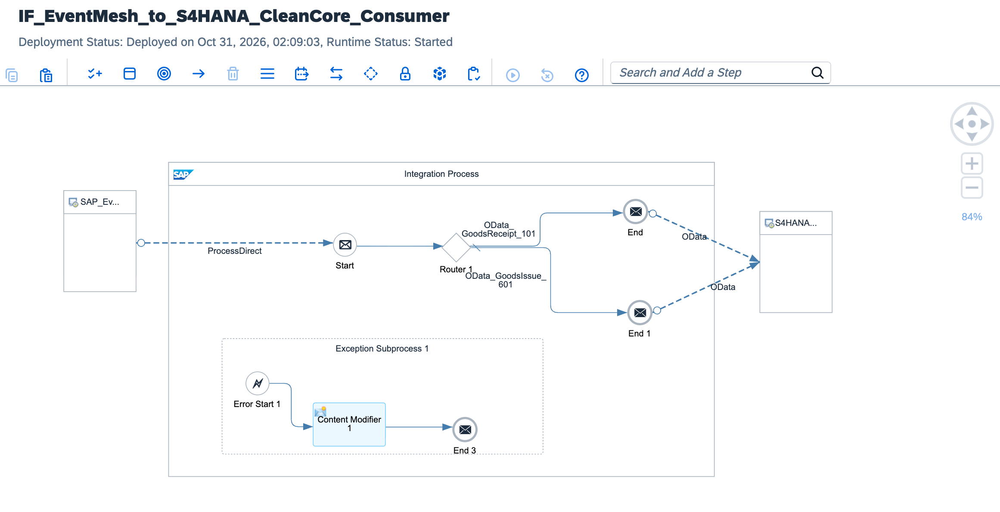

# Enterprise MedTech Architecture: Zero-Trust 3PL Inventory Sync & Clean Core

[](https://www.sap.com)
[](https://help.sap.com)
[](https://www.fda.gov)
[](https://csrc.nist.gov)
[](https://www.sap.com)

---

## Executive Summary

Medical Device manufacturing and distribution requires absolute traceability under **FDA 21 CFR Part 820** and **ISO 13485:2016**. Third-party logistics (3PL) partners synchronizing consigned high-value surgical implants, diagnostic instruments, and sterile batches present severe security and audit vectors if direct database updates or unverified payloads enter SAP S/4HANA.

This architecture establishes an asynchronous, **Zero-Trust Decoupled Supply Chain Pipeline** using an Event-Driven Publisher/Consumer topology:
1. **Cryptographic Ingestion & Pre-Flight Audit (Publisher):** Ingests 3PL physical inventory counts and adjustments via mutual TLS, verifying in-flight SHA-256 HMAC digital signatures in constant-time before payload parsing, then publishing validated events to SAP Advanced Event Mesh.
2. **GS1 Unique Device Identification (UDI) Validation (Consumer):** Subscribes to inventory events and pre-validates GS1 Datamatrix components (GTIN, Lot Number, Expiration Date, Serial Number) in-memory using Groovy rule engines to prevent inventory corruption.
3. **Atomic OData V4 Clean Core Postings:** Bundles multi-item physical inventory adjustments into transactional **OData V4 `$batch` ChangeSets**, eliminating partial postings and maintaining zero core modifications in S/4HANA.
4. **Quarantine Dead-Letter Architecture:** Isolates unauthorized payloads, signature mismatches, or sterile barrier breaches into an encrypted WORM (Write Once, Read Many) Dead-Letter Queue (DLQ) with forensic provenance.

---

## Architecture Overview

This decoupled Clean Core architecture is split into two specialized asynchronous runtime engines communicating via SAP Advanced Event Mesh:

### 1. Inbound 3PL Ingestion & Cryptographic Gatekeeper (Publisher)
Validates mutual TLS, executes constant-time HMAC-SHA256 integrity audits, and dispatches sanitized events to the enterprise event broker.



### 2. Event Mesh to S/4HANA Clean Core Consumer
Subscribes to inventory events, enforces GS1 UDI rules, and executes atomic OData V4 ChangeSet batch postings into S/4HANA without core modifications.



---

## High-Level Topology

```text
[Global 3PL Logistics Partner (Consigned MedTech Inventory)]
  │
  │ HTTPS POST (TLS 1.3 / In-Flight SHA-256 HMAC Signature)
  │ Endpoint: /medtech/zerotrust/inventory/sync
  ▼
[IF_Inbound_3PL_Event_Publisher]
  ├── 1. Context & Security Header Initialization (CM_Init_ZeroTrust_Context)
  ├── 2. Cryptographic Gatekeeper (Verify_HMAC_Signature.groovy)
  │      └─ [Signature Tampered / Invalid] ──► Security Breach Alert (HTTP 403) ──► End
  ├── 3. Event Envelope Packaging (AMQP CloudEvents 1.0)
  └── 4. Outbound Publish ──► [SAP Advanced Event Mesh / BTP Event Mesh]
                                    │
                                    │ Persistent Topic: medtech/inventory/adjustment/v1
                                    ▼
[IF_EventMesh_to_S4HANA_CleanCore_Consumer]
  ├── 1. Event Ingestion & Message Header Enrichment
  ├── 2. UDI Compliance & Serialization Gatekeeper (Validate_MedTech_UDI.groovy)
  │      ├─ Enforces FDA UDI structure (GTIN-14, Lot, Expiration Date, Serial)
  │      └─ Flags sterile barrier breaches or expired medical devices
  ├── 3. Atomic OData V4 Payload Builder (Build_S4HANA_ODataV4_Batch.groovy)
  │      └─ Assembles atomic OData V4 ChangeSet for Physical Inventory Document posting
  ├── 4. Outbound Dispatch: HTTP Adapter (To S/4HANA Cloud OData V4 API)
  └── 5. Exception Subprocess (Zero-Trust Forensic DLQ):
         └─ Captures stack traces & dumps quarantined payloads to forensic audit store
```

---

## Technical Specifications

| Architectural Dimension | Legacy 3PL Point-to-Point Sync | MedTech Zero-Trust Pipeline (Clean Core) |
| :--- | :--- | :--- |
| **Decoupling Pattern** | Synchronous, tightly-coupled point-to-point calls | Asynchronous Event-Driven Publisher/Consumer via Event Mesh |
| **Authentication** | Shared static Basic Auth / API Keys | Mutual TLS (mTLS) + In-Flight SHA-256 HMAC Signatures |
| **Integrity Assurance** | Post-processing ERP error logs | Pre-flight cryptographic message verification in memory |
| **Traceability Standard** | Proprietary material numbers | Strict GS1-128 / FDA UDI format enforcement |
| **ERP Mutation Pattern** | Invasive BAPI calls / Direct DB updates | Atomic OData V4 `$batch` ChangeSets (Clean Core) |
| **Transaction Boundary** | Non-atomic partial line-item commits | All-or-nothing rollback semantics per consignment run |
| **Regulatory Audit** | Manual CSV log reconciliation | Immutable FDA 21 CFR Part 11 compliant audit envelopes |

---

## In-Flight Verification & Atomic Batch Structure

### 1. Inbound In-Flight Verification Headers
```http
POST /http/medtech/zerotrust/inventory/sync HTTP/1.1
Host: integration-suite-eu10.it-cpi026-rt.cfapps.eu10-002.hana.ondemand.com
Content-Type: application/json
X-MedTech-Signature: a5f2b8417cd98e...c678ef4039
X-3PL-Facility-ID: MED-LOG-BERLIN-04
X-UDI-Compliance-Profile: FDA_CFR_820_ANNEX_11
```

### 2. S/4HANA Clean Core OData V4 Batch ChangeSet
```http
--batch_change_set_a891-44bf
Content-Type: application/http
Content-Transfer-Encoding: binary

POST PhysicalInventoryDocumentItem HTTP/1.1
Content-Type: application/json

{
  "FiscalYear": "2026",
  "Plant": "1010",
  "StorageLocation": "CLIN",
  "Product": "SURG-STENT-BIO-09",
  "Batch": "LOT-2026-X99",
  "CountedQuantityInBaseUnit": 45.0,
  "BaseUnit": "PCE",
  "ZeroCountIsZero": false,
  "PhysicalInventoryItemIsCounted": true
}
--batch_change_set_a891-44bf--
```

---

## Repository Structure

```text
├── README.md                                             # Enterprise architecture & operations runbook
├── sap-cpi-medtech-3pl-publisher-architecture.png       # Publisher integration flow runtime topology
├── sap-cpi-medtech-cleancore-consumer-architecture.png  # Consumer integration flow runtime topology
├── ADR-004-Zero-Trust-HMAC-And-Clean-Core-Batching.md    # Architecture Decision Record
├── IF_Inbound_3PL_Event_Publisher.zip                    # Publisher iFlow bundle export
├── IF_EventMesh_to_S4HANA_CleanCore_Consumer.zip         # Consumer iFlow bundle export
├── cpi/
│   └── scripts/
│       ├── Verify_HMAC_Signature.groovy                  # Constant-time SHA-256 HMAC verifier
│       ├── Validate_MedTech_UDI.groovy                   # GS1 UDI & sterile expiration inspector
│       ├── Build_S4HANA_ODataV4_Batch.groovy             # Atomic OData V4 ChangeSet assembler
│       └── Format_ZeroTrust_Forensic_DLQ.groovy          # Forensic tamper incident formatter
├── tests/
│   ├── sample_valid_medtech_inventory.json               # Compliant signed 3PL adjustment payload
│   └── sample_tampered_payload.json                      # Signature mismatch trigger test
└── .gitignore                                            # Git exclusion rules
```

---

## Verification & Deployment Runbook

### 1. Inbound Endpoint Verification
Verify runtime status in **Monitor** ──► **Manage Integration Content**:
```text
https://<tenant-runtime>.cfapps.<region>[.hana.ondemand.com/http/medtech/zerotrust/inventory/sync](https://.hana.ondemand.com/http/medtech/zerotrust/inventory/sync)
```

### 2. Dispatched cURL Test (Security Happy Path)
Execute an authorized POST request using valid 3PL inventory adjustments and cryptographic headers:

```bash
curl -X POST \
  'https://<tenant-runtime>.cfapps.<region>[.hana.ondemand.com/http/medtech/zerotrust/inventory/sync](https://.hana.ondemand.com/http/medtech/zerotrust/inventory/sync)' \
  -H 'Content-Type: application/json' \
  -H 'Authorization: Bearer <BTP_OAUTH_TOKEN>' \
  -H 'X-MedTech-Signature: <COMPUTED_HMAC_SHA256>' \
  --data-binary '@tests/sample_valid_medtech_inventory.json'
```

### 3. Monitoring Trace
* Inspect execution in **Monitor Message Processing**.
* Verify properties `Signature_Valid = true`, `UDI_Compliance_Status = PASSED`, and `ODataV4_ChangeSet_ID`.
* Confirm HTTP 200 response contains the immutable transaction record and Event Mesh correlation token.

---

## Author

**Željko Popov**  
*Integration Architect | SAP Integration Suite & Clean Core Specialist*  
[GitHub Repositories](https://github.com/neurozeljko)
